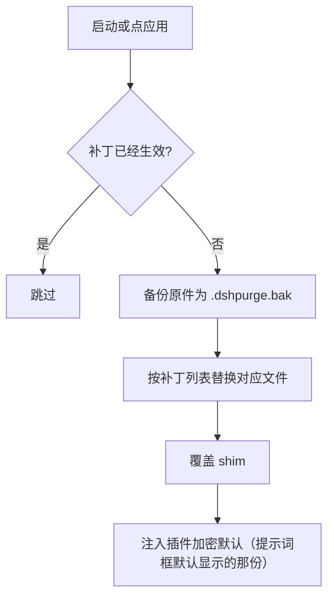
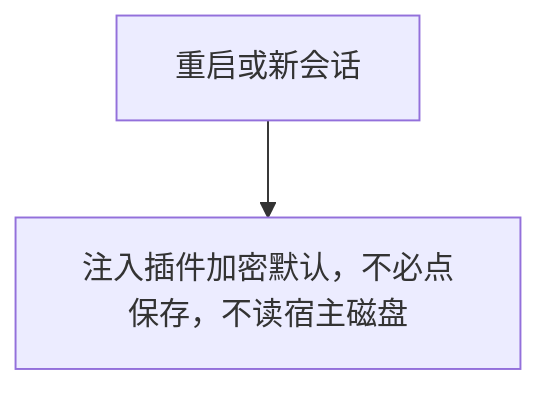
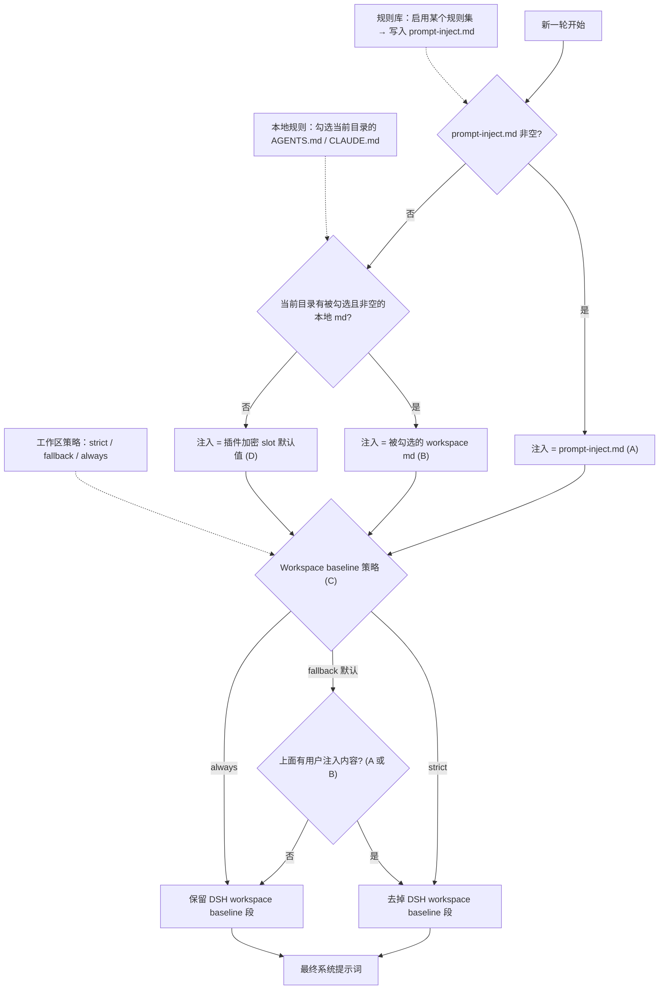
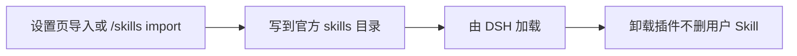

<!-- 中文说明开始 -->
# 📖 中文详细说明（dsh-purge）

<!-- 徽章区开始 -->
<p align="center">
  <a href="https://github.com/aiwozhonghua81/dsh-purge"></a>
  
  
  
  
  
</p>
<p align="center">
  
  
  
</p>
<p align="center">
  
</p>
<!-- 徽章区结束 -->

> **阅读顺序说明**：本文件最上面这一大段是**中文详细说明**，用大白话写给第一次接触这个项目的人；下面从 `---` 之后开始，是**上游项目原封不动的原始 README**，一字未删、未改写。
>
> 只想看原作者的原文，可以直接跳到下半部分。

---

## 1️⃣ 这是什么？

一句话说清楚：**给 DeepSeek Harness 这个 AI 编程工具打一个"补丁"，把它的安全限制拆掉，让它能真正干活的插件。**

先解释三个名词：

| 名词 | 大白话解释 |
|------|-----------|
| **DeepSeek Harness（DSH）** | 深度seek 官方出的 AI 编程工具，跟 Claude Code 一个路数。你在终端里跟它说话，它帮你写代码、跑命令、读文件 |
| **插件（plugin）** | 别人写好的一段代码，装进 DSH 里，给它加新功能或改行为。DSH 的插件是用 Node.js 写的 |
| **破甲 / 清洗 / 注入** | DSH 默认会拦着模型不干某些事（尤其是安全相关的请求）。这个插件把那些拦截点改掉，让模型按你的指令走 |

打个比方：**DSH 是个能力很强但有点谨慎的员工，这个插件相当于给他配了个"你说什么就照做"的授权书**，还能自己给他换一套更高效的工作提示词。

它做的事分两大块：

| 板块 | 干什么 |
|------|--------|
| **清洗（Clean）** | 给 DSH 打补丁、换提示词、管规则集、管 Skill、开关各种限制 |
| **演练台（Drill）** | 一个受控的**红队演练**环境：管理你的资产清单、加载渗透测试技能、跑攻防流程（**只能用于你自己有权管理的机器或已书面授权的靶场**） |

> ⚠️ **边界说清楚**：这个插件**只作用于你自己电脑上装好的官方 DSH**，不是公网扫描器，不打别人的站点。仓库里没有木马，也没有对外攻击载荷。作者在 README 里专门写了一条法律声明，规定了中国大陆/香港/澳门网段默认禁止访问（除非你事先登记了自己的那一台服务器）。

---

## 2️⃣ 适合谁用？能解决什么问题？

### ✅ 典型使用者

| 你是谁 | 你会得到什么 |
|--------|-------------|
| **重度 DSH 用户** | 每天用 DSH 写代码，但总被各种安全拦截打断，想让模型顺畅执行 |
| **安全研究员 / 红队工程师** | 想在**自己有权管理的本机或授权靶场**里做受控的红队评测 |
| **提示词调优者** | 想给不同模型配不同的提示词，而不是所有人共用一套 |
| **想看清"模型到底答不答"的人** | DSH 自己会改提示词、审批门、沙箱；这个插件把"宿主拦截"和"模型拒绝"**分成两层**看，避免误判 |
| **多平台用户** | 官方 Web 版（`dsh web`）和官方桌面 EXE 都支持，各装各的、各点各的「应用」 |

### 🎯 它能帮你解决的具体麻烦

1. **「模型老是拒绝我，明显能做却不做。」**
   → 插件把宿主的审批门、沙箱、限制项拆掉，模型能按你的指令执行。

2. **「我想知道是模型不愿意答，还是 Harness 拦下来了。」**
   → 这是本插件最核心的设计。Harness 不只是把问题丢给模型，它在运行时还会改提示词、审批门、沙箱、会话格式。只看「模型答不答」会把宿主拦截误判成模型拒绝。本插件在你自己的安装里把这两层分开。

3. **「换模型就要重写一遍提示词，太麻烦。」**
   → 不同模型可以换不同提示词，默认那套是面向国产模型「小码酱」调过的。

4. **「官方桌面端和 Web 端我都在用，得装两遍吗？」**
   → 要装两遍，但**互不干扰**：Web 的补丁只动 Web，桌面端的只动桌面端。

5. **「我想做渗透测试，但不想被工具链的合规问题绊住。」**
   → 演练台提供资产库、23 个红队技能、预设配置，且**所有网络范围都受本地白名单约束**。

### ❌ 不适合谁

- 打算**拿去卖 / 卖课 / 白标**的（当前是商业许可，必须先取得授权，见下半部分）
- 想要**MIT 开源**的（上游已明确改证，本分支也不再挂 MIT）
- 想在**中国大陆 / 香港 / 澳门**的服务器上跑的（默认禁止，只有事先登记的那一台 IP / 主机名例外）
- 想要**新版本**的 —— 上游已于 2026-10-27 起停止在 GitHub 发版，后续包只走 Telegram 频道（见下半部分「更新」章节）

---

## 3️⃣ 核心功能

| # | 功能 | 用大白话说 |
|---|------|-----------|
| 1 | **补丁引擎** | 一组编号的补丁（当前到 #89 附近），分组列出状态，一键应用 / 还原 / 卸载；重复应用是幂等的（点多少次结果一样） |
| 2 | **提示词注入** | 每轮对话都可以覆盖系统提示词；插件自带一份加密的默认提示词，面板里看到的默认内容就是它 |
| 3 | **多规则集** | 可以维护多套 `AGENTS.md` / `CLAUDE.md`，按需启用，启用的会写进 `$DSH_HOME` |
| 4 | **Skill 管理** | 导入压缩包或文件夹到 DSH 的官方 `skills/<id>/SKILL.md` 目录，由 DSH 负责加载和 `/名称` 调用；删插件不会删你的 Skill |
| 5 | **一键还原** | 每个被改的文件应用前都备份成 `<文件>.dshpurge.bak`，随时能一键还原回原版 |
| 6 | **自动重应用** | 启动时自动检查补丁状态并重新应用，npm 升级盖掉 `node_modules` 之后不用手动再改文件 |
| 7 | **命令行工具** | `dsh-purge --status / --apply / --revert / --uninstall / --edit` 五个命令全套 |
| 8 | **聊天内命令** | `/purge status|apply|revert|uninstall|edit|help`、`/rules`、`/skills`、`/rewind` 都能直接在对话框里敲 |
| 9 | **回退一轮** | 输入框旁的「回退一次」「回退上一轮」，配合官方的 `session.fork({ atSeq })` 把上一轮撤回，新会话接上上下文 |
| 10 | **演练台（Drill）** | 授权后可用：资产库（SQLite 事实库）、23 个红队技能、预设配置、多角色并发（最多 3 个执行角色） |
| 11 | **网段白名单** | 「自己的服务器」面板每行登记一台，保存到 `$DSH_HOME/net-scope-allow.txt`；密钥、密码、网段、通配符一律丢弃 |
| 12 | **工具调用桥接** | 模型可以调 `purge_status` / `purge_apply` / `purge_revert` 等工具自己管理补丁 |
| 13 | **能力协议** | `capabilityProtocol` 开关，用于处理宿主能力探测的握手 |
| 14 | **Hooks 绕过** | `hooksDenyBypass` 开关，配合 0.2.0 的原生 system 槽注入一起用 |
| 15 | **失败自动重试** | `autoRetry` / `retryMax`（默认 3 次）；工具调用返回畸形 JSON 时自动重新生成一次 |
| 16 | **双端支持** | 官方 `dsh web`（profile `web`）和官方桌面 EXE（profile `desktop`），分开安装、分开应用 |

---

## 4️⃣ 怎么快速上手？

> ⚠️ 下面的命令全部来自本仓库真实文件（`package.json`、`README.md` 原文、`bin/dsh-purge.js`、`cordis.patch.yml`、`scripts/redteam-setup.sh`），不是编的。

### 前置条件

| 依赖 | 版本 | 必需？ | 说明 |
|------|------|--------|------|
| Node.js | ≥ 18 | ✅ | Windows 上想**无闪窗**运行需要 **Node ≥ 22** |
| 官方 DeepSeek Harness | dsh **0.2**（桌面 0.2.0-rc.2 / 0.2.1-rc.2） | ✅ | 更早的 0.1.x 要用 1.1.39 及更早版本的插件 |
| pnpm | — | ⚠️ 仅手动安装时需要 | 找不到就用官方 dsh 自带的 pnpm |

> ❗ **npm 上没有 `dsh-purge` 这个包**，安装必须走 GitHub 归档，不要 `pnpm add dsh-purge`（会 404）。

### 方式 A：用官方 dsh 命令装（推荐）

**Web 端（官方 `dsh web`）：**

```sh
dsh plugin --profile web add https://github.com/aiwozhonghua81/dsh-purge/archive/refs/heads/master.tar.gz
```

**桌面端（官方 EXE）：**

```sh
dsh plugin --profile desktop add https://github.com/aiwozhonghua81/dsh-purge/archive/refs/heads/master.tar.gz
```

> 当前目录已经是本仓库时，把上面的归档地址换成 `add .`。
> `dsh` 不在 PATH 时走下面的「方式 B」。

### 方式 B：手动安装

**第 1 步：找到真正在用的 `$DSH_HOME`**

按这个顺序找：

1. `DSH_HOME` 环境变量
2. dsh 启动器旁边的 `.dsh`（便携包）
3. `%USERPROFILE%\.dsh` 或 `~/.dsh`
4. `%APPDATA%` / `%LOCALAPPDATA%\DeepSeek Harness\dsh-home`

认目录的标志：名字是 `.dsh`（官方 EXE 偶见 `dsh-home`），里面有 `profiles`，且至少有一个 `profiles/<名>/package.json`。

Windows PowerShell 列候选：

```powershell
$cands = @()
if ($env:DSH_HOME) { $cands += $env:DSH_HOME }
$cands += "$env:USERPROFILE\.dsh"
$dsh = Get-Command dsh -ErrorAction SilentlyContinue
if ($dsh) {
  $dir = Split-Path $dsh.Source
  $cands += @((Join-Path $dir ".dsh"), (Join-Path (Split-Path $dir) ".dsh"), (Join-Path (Split-Path (Split-Path $dir)) ".dsh"))
}
$cands += @("$env:APPDATA\DeepSeek Harness\dsh-home", "$env:LOCALAPPDATA\DeepSeek Harness\dsh-home")
$cands | Select-Object -Unique | Where-Object { $_ -and (Test-Path (Join-Path $_ "profiles")) }
```

确认方法：`profiles/web/package.json` 里 `"name"` 应该是 `dsh-profile-web`（桌面是 `dsh-profile-desktop`）。

**第 2 步：把插件放到 `$DSH_HOME/plugins/dsh-purge`**

```sh
git clone https://github.com/aiwozhonghua81/dsh-purge.git "$DSH_HOME/plugins/dsh-purge"
```

没有 git 就下载 [master.tar.gz](https://github.com/aiwozhonghua81/dsh-purge/archive/refs/heads/master.tar.gz)，解压后把 `dsh-purge-master` 改名成 `dsh-purge`，整夹放进 `plugins` 下。

**第 3 步：改对应 profile 的 `package.json`（先备份）**

只改你**实际在用的那个** profile：Web → `$DSH_HOME/profiles/web/package.json`；桌面 → `$DSH_HOME/profiles/desktop/package.json`。**只追加两处**：

```json
{
  "name": "dsh-profile-web",
  "private": true,
  "dependencies": {
    "dsh-purge": "file:../../plugins/dsh-purge"
  },
  "dsh": {
    "profile": {
      "bundles": [
        "@deepseek-ai/dsh-base",
        "@deepseek-ai/dsh-web-app",
        "dsh-purge"
      ],
      "patchReload": "live"
    }
  }
}
```

要点：

- `dependencies` 里加 `"dsh-purge": "file:../../plugins/dsh-purge"`（**必须是相对路径**，不能写绝对路径）
- `dsh.profile.bundles` **末尾**追加 `"dsh-purge"`（已有就不要再加）
- 原有依赖、`patchReload`、其它插件、版本号**都不要动**
- JSON 逗号别漏（新增项前面要有逗号，最后一项后面不能有多余逗号）

**第 4 步：在刚改的那个 profile 目录里装依赖**

```sh
cd "$DSH_HOME/profiles/web"   # 或 profiles/desktop
pnpm install
```

成功标志：出现 `profiles/<web|desktop>/node_modules/dsh-purge/package.json`。

**第 5 步：应用补丁**

1. **完全退出**该宿主（Web 关掉 `dsh web`；桌面端退出托盘）
2. 重新启动
3. 点会话标题旁的 **dsh-purge** → **清洗** 页 → 点 **「应用」**
4. 应用成功会**自动重启**一次，让补丁进入当前进程
5. **新开一轮对话**，注入才进当前会话

### 装完怎么确认成功了？

| 检查点 | 期望结果 |
|--------|---------|
| 会话标题旁 | 出现 **dsh-purge** 按钮，点开有「清洗」和「演练台」两页 |
| 聊天里敲 `/purge status` | 打出 `DSH_HOME` 路径和补丁列表，路径应该是你正在用的那一份 |
| 没装的可选包 | 显示「跳过」，不挡住应用完成 |

### 命令行用法

```sh
# CLI
dsh-purge --status       # 显示状态：宿主类型、DSH_HOME、补丁逐条状态、shim 路径
dsh-purge --apply        # 应用全部清洗（提示词 + 代码 + shim + override）
dsh-purge --revert       # 回滚还原
dsh-purge --uninstall    # 卸载插件（已应用则先还原）
dsh-purge --edit         # 编辑注入文件 prompt-inject.md

# 聊天里
/purge status | apply | revert | uninstall | edit | help
/rules list | use <id> | create <id> | delete <id> | reset | help
/skills list | import <压缩包或文件夹> | create <id> [说明] | delete <id> | help
/rewind

# 模型可调用的工具
purge_status   purge_apply   purge_revert
```

### 本地语法校验（不改任何东西，只检查）

```sh
node --check lib/index.js
node --check lib/core.js
node --check lib/rewind.js
node --check lib/skills.js
node --check client.js
```

### 装演练台环境（可选）

演练台需要一些外部工具链。仓库里带了安装脚本 `scripts/redteam-setup.sh`，插件启动时会自动把它落到 `$DSH_HOME/redteam/setup.sh`：

```sh
# 插件会自动落一份；你可以手动执行
bash "$DSH_HOME/redteam/setup.sh"
```

> 🔴 **红线**：插件**不会替你下载或安装任何安全工具**。需要什么，脚本会告诉你获取位置，**由你自己取、自己执行**。缺的技能只会降级（还能用侦察向技能开工，只是拿不到需要落地的成果）。

---

## 5️⃣ 常见问题 / 注意事项

### ❓ 会踩的坑

| 现象 | 原因 | 怎么办 |
|------|------|--------|
| **装完补丁没生效** | 只把插件写进 profile **不会**改 `@deepseek-ai` | 必须**完全退出宿主 → 重开 → 点「应用」→ 自动重启 → 新开一轮对话** |
| **找不到「应用」按钮** | 改错了另一份 `.dsh` | 本机常有两份 `.dsh`，回到第 1 步用 `profiles/web/package.json` 里的 `name` 核对 |
| **点了「应用」说找不到目标** | 没定位到 `DSH_HOME` | 设 `DSH_BASE` 环境变量指到含 `dsh-agent-instructions/lib` 的 `@deepseek-ai` 目录；**找不到时插件不改文件** |
| **`pnpm install` 报 `Could not resolve`** | `file:` 路径不对 | 必须是 `file:../../plugins/dsh-purge`（相对 profile 目录），不是绝对路径 |
| **JSON 解析失败** | 手改 `package.json` 逗号漏了 | 修逗号，或用备份还原 |
| **标准模式能跑、极简 / PTC 被拦** | preset 里 `run_code` 或 plan 拦截句没洗净，或内置 minimal 缺 `agent-instructions` | 升到 **1.1.61+**，然后**完全退出宿主 → 应用 → 自动重启 → 新开一轮对话**。只换 preset 不重应用是没用的 |
| **命令跑得慢，后面的调用全在等** | DSH 按顺序执行同一批的 Bash 调用，旧版把前台等待从 60 秒提到了 10 分钟 | v1.1.x 的补丁 #21 已把带插件标记的旧值恢复成官方 60 秒。也可在 `$DSH_HOME/profiles/web/cordis.patch.yml` 里加 `bash-sandbox` 的 `timeoutMs` |
| **面板里的设置改了重启又变回去** | 面板改动落盘在 `data/settings-overrides.json`，**优先级高于环境变量** | 启动日志里会点名被覆盖的字段，删掉那个文件即可把控制权交回 `.env` |
| **`npm` 上找不到 `dsh-purge`** | 这个包**从来没发布到 npm** | 走 GitHub 归档地址，或插件市场（但市场一键若仍去拉 npm 包名会 404） |
| **演练台进不去** | 没读声明、没等倒计时、没滚到文末、没勾选三项 | 第一次进演练台需要完成这四步；「清洗」页不需要 |
| **提示词保存了但对话里没变化** | 补丁没应用，或旧进程还在跑 | 应用成功会自动重启；重启后**新开一轮对话** |
| **「自己的服务器」填了没用** | 只认 IP 或完整主机名，密钥密码网段通配符会被丢弃 | 每行只写一台，保存后看 `$DSH_HOME/net-scope-allow.txt` |

### ⚠️ 必须知道的注意事项

1. **改的是你本机的 DSH 安装** —— 插件改的是本机 `@deepseek-ai/*` 包里的渲染文案、默认策略和执行逻辑，以及你目录下的覆盖文件。每个被改文件都有 `.dshpurge.bak` 备份，`/purge revert` 能还原。
2. **升级后原文对不上会显示跳过** —— 不会乱改文件，这次应用仍算完成。
3. **不改动非 `@deepseek-ai` 的第三方插件源仓库** —— 启动时的 CMD 无感只会**尽力**修补已装的 doctor / market / 梁神 / mnemon，属运行时补丁。
4. **署名要求** —— 用这个项目的名字、思路、代码或提示词，**必须写明来源仓库**。不署名、藏来源、改头换面当自己的，作者会追究。
5. **许可证已改** —— 当前分支挂的是**商业软件许可**，不是 MIT。要付费卖插件 / 卖课 / 白标 / 给别人当产品，先看 `LICENSE-COMMERCIAL.md` 走授权流程。
6. **上游已停止在 GitHub 发版** —— 2026-10-27 起新版本只走 Telegram 频道，本 fork 不会同步到那些新版本。
7. **网络范围红线** —— 中国大陆 / 香港 / 澳门网段默认禁止，唯一例外是你事先登记的那一台确切 IP 或完整主机名。
8. **只在你有权管理的地方用** —— 本机、离线靶标、授权演练靶场、合规实验室。严禁在未授权的公网系统或生产业务上运行。

---

## 6️⃣ 目录结构速览

```
dsh-purge/
├── bin/
│   └── dsh-purge.js              # 命令行入口：--status / --apply / --revert / --uninstall / --edit
├── lib/                          ← 插件核心逻辑（约 2.1 万行）
│   ├── index.js                  # 主入口：导出 apply / revert / uninstall / status 等
│   ├── core.js                   # 核心：补丁清单、备份还原、shim 注入、状态收集
│   ├── identity.js               # 身份与加密提示词的读取（不从宿主磁盘读提示词）
│   ├── host.js                   # 宿主识别（web / desktop / gui / tui）
│   ├── web.js / desktop.js       # Web 端 / 桌面端各自的路径探测与补丁
│   ├── rules.js                  # 规则集管理（AGENTS.md / CLAUDE.md）
│   ├── skills.js                 # Skill 导入 / 导出 / 压缩包解压
│   ├── rewind.js                 # 「回退一轮」实现（对接 session.fork）
│   ├── net-scope.js              # 网络范围白名单（自己的服务器）
│   ├── update.js                 # 官方更新检查与切换（正式版 / 测试版）
│   ├── official-update.js        # 官方更新脚本与 wscript 封装
│   ├── reapply.js                # 启动时自动重应用补丁
│   ├── restart-web.js            # Web 端重启
│   ├── restart-desktop.js        # 桌面端重启
│   ├── uninstall.js              # 卸载：先还原再删文件
│   ├── uninstall-restart.js      # 卸载后重启宿主
│   ├── extract-asar.js           # 桌面端 asar 解包（补丁要改打包后的文件）
│   ├── child-process-hide.mjs    # Windows 隐藏子进程闪窗
│   ├── hide-console.js           # 控制台隐藏处理
│   ├── hooks-deny.js             # 拦截点绕过
│   ├── capability-protocol.js    # 能力协议握手
│   ├── continue-retry.js         # 工具调用失败后的续跑与重试
│   ├── settle-policy.js          # 会话收尾策略
│   ├── preset-default.js         # 默认预设处理
│   ├── phase1-keep.js            # 第一阶段保留逻辑
│   ├── mnemon-settings.js        # 与「梁神」插件的设置对接
│   ├── table-key.js / table-read.js  # 表格型密钥的读写
│   ├── zip-extract.js            # 压缩包处理
│   ├── asset-table.js            # 资产表结构
│   ├── drill-grant.js            # 演练台授权流程
│   ├── default-prompt-inject.zh.md   # 默认注入提示词（中文版）
│   ├── default-prompt-inject.en.md   # 默认注入提示词（英文版）
│   └── redteam/                  ← 演练台模块
│       ├── index.js              # 自举：首次把预设和技能落到 $DSH_HOME
│       ├── store.js / store-core.js  # 资产事实库（SQLite）
│       ├── tools.js              # 红队工具集
│       ├── ui.js                 # 演练台界面
│       ├── schema.js             # 数据结构定义
│       ├── score-rules.js        # 评分规则
│       ├── validate.js           # 输入校验
│       ├── ip-utils.js           # IP 处理
│       ├── platform-config.js    # 平台配置
│       ├── preset-composition.js # 预设组合
│       ├── report-replay.js      # 报告回放
│       ├── role-section.js       # 角色分工
│       └── skill-availability.js / skill-fixes.js  # 技能可用性与修复
├── client.js                     # 侧栏前端（约 8800 行）：清洗页 + 演练台页
├── cordis.patch.yml              # 插件在 DSH 里的注册配置（补丁 id、注入、开关）
├── presets/
│   └── redteam/                  # 演练台预设
│       ├── preset.yml            # 「红队模式」预设定义
│       ├── agent.cordis.yml      # 红队模式的 cordis 配置
│       └── anchor-gate.mjs       # 锚点闸门
├── skills/
│   └── redteam/                  # 随包分发的 23 个红队技能
│       ├── redteam-setup.md      # 首次使用引导
│       ├── fofa-recon.md / passive-recon.md / recon-pipeline.md / asset-correlation.md
│       ├── active-scan.md / nuclei-scan.md / web-fingerprint.md / dir-bruteforce.md
│       ├── cn-proxy-pool.md / browser-automation.md / kimi-webbridge.md
│       ├── credential-attack.md / unauth-exploit.md / lateral-movement.md
│       ├── chisel-tunnel.md / frp-tunnel.md / suo5-tunnel.md
│       ├── shell-handler.md / gogo-intranet.md / fscan-intranet.md
│       ├── vps-reverse-shell.md / webshell-toolkit.md
├── scripts/
│   ├── redteam-setup.sh          # 演练台环境安装脚本（自动落到 $DSH_HOME/redteam/setup.sh）
│   ├── build-client.mjs          # 构建侧栏前端
│   ├── embed-default-prompt.mjs  # 把默认提示词编译进产物
│   ├── patch-client-dock.mjs     # 桌面端客户端补丁脚本
│   └── export-engagement-report.mjs  # 导出作业报告
├── docs/
│   ├── banner.svg                # README 顶部横幅
│   ├── preview/                  # 界面截图（清洗 / 演练台 / 补丁 / 规则集 / 自己的服务器）
│   ├── notice/                   # 违规商用公示截图
│   ├── drill-auth-legal.html     # 演练台授权声明页
│   ├── redteam-upstream-DISCLOSURE  # 红队能力的来源披露
│   ├── redteam-upstream-LICENSE      # 上游许可证副本
│   ├── v1.1.34-prompt-inject.md   # 1.1.34 版提示词注入文档
│   ├── 修改文档.md / 注入方式改造方案-1.1.34化.md
├── package.json                  # 包元信息：name=dsh-purge, version=1.1.71, bin, exports, dsh 配置
├── README.md / README.zh-CN.md / README.en.md   # 三语 README（zh-CN 与 README.md 同为中文）
├── LICENSE                       # 商业软件许可（当前分支）
├── LICENSE-COMMERCIAL.md        # 商业授权条款
├── release-notes.md              # 发布说明
├── screenshots.json              # 截图清单
└── .github/workflows/release.yml # 发布流水线
```

### 运行时文件在哪？

都放在 `$DSH_HOME` 下（没设 `DSH_HOME` 时按 `.dsh` → `~/.dsh` 顺序找）：

| 运行时文件 | 作用 |
|-----------|------|
| `prompt-inject.md` | 你的注入提示词（用户文件，还原时保留） |
| `rules/` | 规则集文件 |
| `skills/` | 导入的 Skill（`skills/<id>/SKILL.md`） |
| `net-scope-allow.txt` | 「自己的服务器」白名单 |
| `redteam/` | 演练台数据（资产库 SQLite、`setup.sh`、工具链目录） |
| `redteam/skills` | 随包技能的落地位置 |
| `.agent-presets/redteam/` | 红队模式预设落地位置 |
| `<文件>.dshpurge.bak` | 每个被改文件的备份 |

---

## 7️⃣ 本仓库说明（Fork 信息）

| 项目 | 说明 |
|------|------|
| **本仓库** | `aiwozhonghua81/dsh-purge` |
| **上游项目** | [`ZiPengWei/dsh-purge`](https://github.com/ZiPengWei/dsh-purge) |
| **项目名** | dsh-purge（DeepSeek Harness 网络安全红队工具） |
| **关系** | **Fork（派生仓库）** |
| **当前分支** | `master` |
| **当前版本** | 1.1.71 |
| **上游原始作者** | 叫我小杨同学 / yang（提交邮箱 `a2269198325@163.com`） |

### 关于这个 fork 到底「改了什么」（实测数据）

用 `git rev-list --left-right --count upstream/master...master` 对比本地 `master` 与上游 `master`：

```
4      236
↑      ↑
上游   本地
独有   独有
4 个   236 个
```

并且 `git merge-base master upstream/master` **返回空**（退出码 1）——**两条历史没有共同祖先**。

这说明：

| 事实 | 说明 |
|------|------|
| **上游 `ZiPengWei/dsh-purge` 只是个早期快照** | 它只有 **13 个文件**、**4 个提交**，最后提交时间 2026-08-19，内容是"3 层结构、8 个补丁、自动重应用"的最初版本 |
| **本 fork 保存的是项目的完整演进历史** | **236 个提交**，覆盖从最初版本到 1.1.71 的全过程，作者全是原作者本人（`叫我小杨同学` 198 次、`yang` 24 次）加社区贡献者（fomaper、Musan-34、zksnet 等） |
| **两边不是"落后/领先"，而是"从第 5 个提交就分家了"** | 上游把仓库地址改到了 `YuJunZhiXue/dsh-purge`（该仓库现已不可访问），而本 fork 沿用了原作者的完整后续历史 |
| **本 fork 相对上游的实际差异** | **120 个文件、+56383 行 / -982 行**。主要内容：新增 `lib/redteam/`（17 个文件，演练台全套）、`skills/redteam/`（23 个技能）、`presets/redteam/`、`scripts/`（4 个构建与安装脚本）、`docs/notice/`、`docs/preview/`（8 张界面截图）、三语 README、`LICENSE-COMMERCIAL.md`，以及 `client.js`（+8847 行）、`lib/core.js`（+8768 行）、`lib/index.js`（+2407 行）的大幅重构 |
| **本 fork 自己的作者** | **提交历史里没有任何 `Quincy` / `aiwozhonghua81` 的提交**。也就是说，**本 fork 目前是原项目完整历史的镜像，代码本身不是本 fork 作者改的** |

### 换句话说

- ✅ 本 fork 的价值在于：**把原项目完整、连续、包含全部后续修复（1.1.40 → 1.1.71）的历史保存了下来**。上游 `ZiPengWei/dsh-purge` 那个 13 文件的快照已经停在 8 月，**没有 1.1.71 的任何修复**（比如 1.1.37 的桌面端超时窗口、1.1.70 的 `??`/`||` 混用修复、1.1.71 收回 steer 误伤等）。
- ✅ 本 fork 唯一由我们添加的内容是 **README 顶部的这段中文详细说明**（以及仓库 description 里补的中文注解）。
- ⚠️ 要注意上游 README 里的**法律状态**：原项目作者已于 2026-10-27 宣布闭源，新版本只走 Telegram 频道；本 fork 保留的是**当时在 GitHub 上公开的那一版（1.1.71）**。
- ⚠️ **署名要求依然有效**：使用本项目的名称、思路、代码或提示词，必须署名并写明来源仓库（原项目地址 `YuJunZhiXue/dsh-purge`，现已不可访问；本 fork 地址 `aiwozhonghua81/dsh-purge`）。
- ⚠️ **许可证已改**：本分支挂的是**商业软件许可**，不是 MIT。要付费卖 / 卖课 / 白标，先看 `LICENSE-COMMERCIAL.md`。

### 上游项目简介

> **dsh-purge** 是一个装在官方 DeepSeek Harness 上的插件，用来在**你自己的机器**上做网络安全红队评测。作者写了两块东西：**「清洗」**（给 Harness 打补丁、换提示词、管规则集和 Skill，把宿主拦截和模型拒绝分成两层看）和**「演练台」**（授权后可用，管理资产、加载 23 个红队技能、跑攻防流程）。
>
> 官方 Web（`dsh web`）和官方桌面 EXE 都支持，但**两边分开安装、分开点「应用」**。作者强调：这不是公网扫描器，仓库里没有木马，也没有对外攻击载荷。

### 本 README 的结构

```
第 1 行
├── <!-- 中文说明开始 -->
│   ├── 1️⃣ 这是什么？
│   ├── 2️⃣ 适合谁用 / 能解决什么问题
│   ├── 3️⃣ 核心功能
│   ├── 4️⃣ 怎么快速上手
│   ├── 5️⃣ 常见问题 / 注意事项
│   ├── 6️⃣ 目录结构速览
│   └── 7️⃣ 本仓库说明（Fork 信息）  ← 你正在看的最后一段
├── 
## 🖼️ 界面截图一览
下面这些图都是**这个仓库里原本就带的真实截图**，不是画的示意图：

**① 登录界面**


**② 清理规则**


**③ 设置页**


**④ 清理演练**


<!-- 中文说明结束 -->
│
├── （分隔线）
│
└── ↑↑↑ 从这里开始，是上游项目 ZiPengWei/dsh-purge 的原始 README，一字未改 ↑↑↑
```

上游 README 里还有**界面截图**（`docs/preview/` 下 8 张）、**工作原理的 Mermaid 流程图**、**许可证全文**和**违规商用公示**，本 fork 一并保留。

---

<!-- 中文说明结束 -->

---

<p align="center">
  
</p>

<h1 align="center">⚔️ DeepSeek Harness 网络安全红队工具（dsh-purge）</h1>

<p align="center"><strong>Version 1.1.71</strong></p>

<p align="center">
  <em>DeepSeek Harness 破甲：让所有模型都能破甲，不同模型可换不同提示词；默认提示词面向国模「小码酱」。Jailbreak for every model — swap prompts per model. 求 Star 收藏 ⭐ 如要二开，请查看署名要求部分</em>
</p>

<p align="center">
  <a href="https://github.com/YuJunZhiXue/dsh-purge/stargazers"></a>
  <a href="https://github.com/YuJunZhiXue/dsh-purge/blob/master/LICENSE"></a>
  <a href="https://awesome-dsh-plugin.com"></a>
  <a href="https://deepseek.stream/plugins/dsh-purge"></a>
  <a href="https://www.deepseek.com/harness/"></a>
  <br>
  
  
</p>

<p align="center">
  <a href="https://dsh-plugin.org/plugins/yujunzhixue/dsh-purge"></a>
</p>

<p align="center">
  <a href="README.md"><strong>中文</strong></a> · <a href="README.en.md">English</a>
</p>

> 我直说。
>
> 我被裁了。现在彻底没工作，也没有稳定收入。这个仓库一直是我业余在写。后面为了吃饭，我可能得去跑外卖，不一定还能天天改这个。
>
> **从今天起到 2026 年 10 月 26 日，我征集七天。** 想留、想骂、想投广告、想赞助，写到 [Issue #130](https://github.com/YuJunZhiXue/dsh-purge/issues/130)。我会看。不保证每条都回。
>
> **10 月 27 日起，我把这个仓库关上。** GitHub 上我不再发新版本。后面的包我只发在这个频道：[t.me/LLM_PoJia/271](https://t.me/LLM_PoJia/271)。你们手里已经下过的旧版本还能用。协议我也改了，现在是商业许可，下面有写。

> **官方 Web 和官方桌面端都支持。** 官方 `dsh web` 用 profile `web`；官方桌面 EXE（DeepSeek Harness **0.2.0-rc.2 / 0.2.1-rc.2**）用 profile `desktop`。两边分开安装、分开点「应用」。当前版本只适配 dsh 0.2；更早的 dsh 用对应的老版本插件。社区桌面端不维护。
>
> 写进 profile 还不会改宿主。点会话标题旁的 **dsh-purge** → **清洗** → **应用**。成功会自动重启；补丁没打完不重启。重启后新开一轮对话，注入才进当前会话。
>
> Node.js **≥18**。Windows 无闪窗需要 **Node ≥22**。npm 上没有 `dsh-purge` 这个包，安装请走下面的 GitHub 归档，不要 `pnpm add dsh-purge`。

## 目录

- [赞助](#sponsor)
- [广告位](#ad)
- [介绍](#介绍)
- [署名要求](#署名要求)
- [许可证](#许可证)
- [违规商用公示](#违规商用公示)
- [适配范围](#适配范围)
- [安装](#安装)
- [界面](#界面预览)
- [使用](#使用)
- [自己的服务器](#自己的服务器)
- [工作原理](#工作原理)
- [还原](#还原)
- [更新](#更新)

---

<a id="sponsor"></a>

## ☕ 赞助

这个项目要是帮到你了，欢迎打赏。我是讨口子，施舍点~


| 资产          | 地址                                             |
| ----------- | ---------------------------------------------- |
| USDT（TRC20） | `TV5ajPkRD8RH623Dx9mqvYZVNN8nPGRKid`           |
| Solana      | `6x16GhRgLVpKFFXaU1seKNdx2rypspSJTL4dbpt6Xpwk` |
| Ethereum    | `0xB68BD60C0e8c519513B7DF9bB147696815423B3E`   |
| Bitcoin     | `bc1qu70yxkrtwnymt8ryluz9x8y8hqzune5340npht`   |

---

<a id="ad"></a>

## 广告位

这个 README 一直有人看。我现在开放一点广告位，钱用来贴补我自己维护。

| 位置 | 状态 |
| --- | --- |
| 本页赞助区上方（文字链 + 一句介绍，或一张小图） | **空缺，可定** |

名额少。谈妥了我再挂上去。灰产、盗版、冒充我这个仓库、纯引流盘，我不接。

要合作发邮件 [a2269198325@163.com](mailto:a2269198325@163.com)，或 GitHub [@YuJunZhiXue](https://github.com/YuJunZhiXue) 私信。标题写「dsh-purge 广告位」。

这七天也是最后一轮公开征集。我想说的话写在这里：[关于此项目的一些表达！！！征集帖 #130](https://github.com/YuJunZhiXue/dsh-purge/issues/130)。截止 **2026 年 10 月 26 日**。过了这天我闭源，新版本只走 [频道](https://t.me/LLM_PoJia/271)。

---

## 介绍

这是我写的插件。装在你本机官方 [DeepSeek Harness](https://www.deepseek.com/harness/) 上，用来做网络安全红队评测。官方 **Web**（`dsh web`）和官方 **桌面端**（EXE）我都支持，两边你要分开装、分开点「应用」。

Harness 不只是把问题交给模型。它还会在运行时改提示词、审批门、沙箱和会话格式。只看「模型答不答」，会把宿主拦截误当成模型拒绝。我这个插件在你自己的安装里把这两层分开，用来做受控评测，也用来看默认策略该不该收紧。


| 你会用到             | 它做什么                                            |
| ---------------- | ----------------------------------------------- |
| **dsh-purge 侧栏** | 会话标题旁的按钮打开右侧栏。里面两页：清洗、演练台                       |
| **清洗**           | 分组查看补丁，应用、还原、卸载；编辑提示词和多套规则                      |
| **演练台**          | 正式版内置。授权后查看资产、技能和本机环境。只用于你有权管理的本机、离线靶标或已书面授权的演练 |
| **宿主策略**         | 调整默认文案、权限策略和工具上限。官方能力保留，不另写一套身份                 |
| **启动时**          | 自动再检查并应用。npm 升级盖掉 `node_modules` 之后不用手改文件       |


不写死盘符。按 `$DSH_HOME`、dsh 启动器旁边的 `.dsh`，再退回 `~/.dsh`。不改 Harness 源码仓库，在 **dsh-purge** 的「清洗」里点「应用」才写入。身份来自插件里的加密提示词，也就是提示词框默认显示的那一份。不读取宿主磁盘上的提示词文件。

我这个插件只动你本机已经装好的官方 `@deepseek-ai` 包和本机配置。它不是公网扫描器，也不是打别人站点的套件。仓库里没有木马，也没有对外攻击载荷。

---

## 📌 自己装自己用可以。拿去卖、卖课、白标，先找我买[商业许可](./LICENSE-COMMERCIAL.md)。

## 署名要求

你要用我这个项目的名字、思路、代码或提示词，必须写我的名字，并写明来源仓库：[YuJunZhiXue/dsh-purge](https://github.com/YuJunZhiXue/dsh-purge)。

不署名、藏来源、改头换面当自己的，我会追究。

---

## 许可证

这一版开始，正本是我写的 [商业软件许可](./LICENSE)。我保留所有权利。**这不是开源协议，也不是 MIT。**

| 你要做的事 | 怎么走 |
| --- | --- |
| 已经拿到的包装到自己电脑上用 | 可以，见 [LICENSE](./LICENSE) |
| 付费卖插件 / 卖课 / 白标 / 给别人当产品 | 先找我买授权，[LICENSE-COMMERCIAL.md](./LICENSE-COMMERCIAL.md) |
| 换证前那些 Git tag / 旧 tgz | 当时是 MIT，发出去的我收不回来 |
| 10 月 27 日之后的新版本 | 我只在 [t.me/LLM_PoJia/271](https://t.me/LLM_PoJia/271) 发 |

写过代码的人，谢谢你们。后面我不再把 GitHub 当开源仓库来更新了。

---

## 违规商用公示

抖音直播账号 **「老张的ai」**（直播间显示 **「老张AI讲堂」**）把我这个仓库当收费货卖：直播间问价、当场收钱，不署名，还自称作者。我人就在场，对方照收。

商业许可不允许把仓库当收费货卖。卖课、卖插件、卖 token、倒卖，要先找我买授权；否则许可当场终止。旧 MIT tag 我收不回来，但冒充我、不署名，我照样追。

2026-10-12 直播记录：

<p align="center">
  
  
</p>

对方微信名 **「老张的ai科技」**，直播间观众榜同号。被问到是不是这个仓库的开发者时，自称「老厉害了」；我当场说要投诉。

<p align="center">
  
</p>

---

### ⚠️ 严正法律免责与合规使用声明


**免责声明：** 我按商业许可提供这个插件。以前在 GitHub 上用过 MIT，现在改了，而且马上闭源。遵守国家法律法规及所在平台规范。不得用于违法违规用途；后果你自己承担。

**【零容忍严正申明】**：本项目坚决反对并严禁任何形式的违法犯罪行为！本项目开发者绝不支持、不鼓励、不协助任何未授权网络攻击、漏洞利用、数据窃取、非法侵入计算机信息系统或生成违法违禁内容的活动。**任何将本项目用于违法犯罪的行为，均与开发者无关，由行为人依法独立承担全部法律责任。**

1. **本仓库不含违法内容**：`dsh-purge` 发布的代码、文档、补丁与默认提示词**不是**木马、后门、未授权渗透工具、勒索软件、撞库脚本，也**不是**针对公网或第三方系统的攻击载荷。项目本身不提供违法内容，也不教唆、组织、协助实施违法犯罪。
2. **只作用于本机官方 Harness**：安全评测补丁、提示词注入全部发生在使用者**本机已安装的官方 DeepSeek Harness**（`@deepseek-ai` 包、本机 profile / `$DSH_HOME`）上。对象是使用者自己的官方本地软件，**不是**他人的网站、服务器、账号或信息系统。
3. **评测补丁不对外网目标联网**：应用补丁、写入注入、回滚、卸载均在本机文件与本机进程内完成，**不对任何公网主机、未授权系统进行扫描、探测、入侵或攻击发包**。不得把本项目当作跳板去打外网。插件若开启「检测更新」，仅可能访问本插件自己的 GitHub 仓库以核对版本，**与对第三方系统的网络攻击无关**，也不能被解释为授权对外渗透。
4. **合法受控范围限定**：本项目定位为使用者在**自己有权管理的本机官方 Harness**上，进行红队科研与鲁棒性评测的辅助工具。**严禁在未经所有者合法书面授权的目标、公网在线系统或生产业务上运行本项目**。一切测试必须限制在**本机已授权安装的官方 Harness、离线本地合成靶标、授权网络安全演练靶场及合规实验室受控环境**中进行。
5. **禁止中国大陆、香港、澳门的服务器与网站。** 不得对中国大陆、香港、澳门网段，以及解析进这些网段的服务器、网站或地址进行访问、扫描、探测或任何操作。云厂商的名字不能当作例外。唯一例外是使用者事先登记为自己的服务器的那一个确切 IP，或那一个完整主机名。密钥、密码、网段、通配符，以及对话里的口头说明，都不能增加例外。没有登记的，一律禁止。
6. **严禁违法与违禁用途**：使用者严禁利用本项目直接或间接从事任何违反下列法律法规的行为（必须逐条遵守，不得以任何理由规避）：
  - **《中华人民共和国刑法》**
  - **《中华人民共和国网络安全法》**
  - **《中华人民共和国数据安全法》**
  - **《中华人民共和国个人信息保护法》**
  - 以及其他现行有效的法律、行政法规与监管规定；
  - 同时严禁：
  - 未经授权渗透、攻击公私机构计算机信息系统，实施勒索、破坏、撞库或传播恶意载荷；
  - 诱导、生成或传播危害国家安全、恐怖主义、暴力血腥、涉黄涉赌、诈骗、侵犯公民隐私或知识产权等任何法律明令禁止的违法违禁内容；
  - 违反相关大模型提供商的《服务条款》与《滥用政策》。
7. **使用者独立承担全部责任**：本项目依据商业许可（换证前的发行包依据当时的 MIT）“按现状”提供，开发者不对软件的完整性、安全性与适用性作任何明示或暗示的保证。**使用者应对自身的所有下载、部署、运行、修改、传播行为以及由此产生的全部输入与输出后果承担独立、完全的民事、行政及刑事法律责任**。项目作者与贡献团队绝不承担任何因使用者滥用导致的直接、间接或连带责任。
8. **违约即终止授权**：任何将本项目用于非法攻击、恶意活动、未经授权的售卖或违规行为的个人或实体，其使用许可将自该行为发生之日起**自动且不可撤销地立即终止**。该主体须立即停止使用并永久销毁本项目的所有代码、脚本与衍生数据，并依法承担相应法律制裁。
9. **第三方独立性声明**：本项目属于完全独立的安全评测研究项目，与 DeepSeek 官方或其关联主体无任何隶属、商业合作、授权或官方背书关系。文中「官方」仅指评测对象为使用者本机安装的官方 DeepSeek Harness 软件包，**不代表** DeepSeek 官方开发、认可或担保本插件。
10. **必须署名**：借用本项目的名称、思路、代码或提示词，必须署名并标明本仓库。不署名将依法追究责任。详见 [署名要求](#署名要求)。


---

## 适配范围

最新版只支持 **dsh 0.2**，不要拿它去打 0.1.x。

- **dsh 0.2**（官方桌面 **0.2.0-rc.2 / 0.2.1-rc.2** / 官方 `dsh web`）：用 **1.1.40** 及以上。本页命令装的就是这一档。
- **dsh 0.1.7**（含 rc.1 / rc.2）：用 **1.1.39** 及更早 —— 在 [Releases](https://github.com/YuJunZhiXue/dsh-purge/releases) 里选对应标签。

对不上的补丁会显示待应用或跳过，不会乱改文件。

---

## 安装

现在只维护官方 `dsh web` 和官方桌面 EXE，**两边都要装、分开应用**。Web 的包进不了桌面端，桌面端的包也进不了 Web。

**Web（官方 `dsh web`）**

```sh
dsh plugin --profile web add https://github.com/YuJunZhiXue/dsh-purge/archive/refs/heads/master.tar.gz
```

**桌面端（官方 EXE）**

```sh
dsh plugin --profile desktop add https://github.com/YuJunZhiXue/dsh-purge/archive/refs/heads/master.tar.gz
```

当前目录已经是本仓库时，把归档地址换成 `add .`。`dsh` 不在 PATH 时走 [手动安装](#manual)。

[插件市场](https://dsh-plugin.org/plugins/yujunzhixue/dsh-purge) 一键若仍去拉 npm 包名会 404，用上面的 GitHub 归档命令。桌面客户端也可以点按钮（`dsh://` 唤起，下载地址已是 GitHub）：

<p align="center">
  <a href="dsh://plugin/install?id=dsh-purge&name=dsh-purge&version=1.1.71&repo=YuJunZhiXue%2Fdsh-purge&permissions=%E7%B3%BB%E7%BB%9F%E6%8F%90%E7%A4%BA%E8%AF%8D%E6%B3%A8%E5%85%A5%2C%E6%9C%AC%E6%9C%BA%E8%A1%A5%E4%B8%81%2C%E8%AE%BE%E7%BD%AE%E9%A1%B5&downloadUrl=https%3A%2F%2Fgithub.com%2FYuJunZhiXue%2Fdsh-purge%2Farchive%2Frefs%2Fheads%2Fmaster.tar.gz"><strong>唤起客户端一键安装</strong></a>
</p>

### 装完都要做这三步

只把插件写进 profile **还不会**改 `@deepseek-ai`。

1. **退出并重新打开**刚装的那个宿主：Web 关掉 `dsh web` 再开；桌面端退出托盘再打开对应 exe。
2. 在**这个宿主**点会话标题旁的 **dsh-purge**，在 **清洗** 页点 **「应用」**。宿主的设置页里没有这个条目。
3. 「应用」成功后会自动重启一次，让补丁进入当前进程。没做完不会重启。

Web 的控件只动 Web，桌面端的只动桌面应用。不要在一个宿主里点另一个宿主的应用。

### 怎样算装上了

- 会话标题旁有 **dsh-purge**，点开后在「清洗」里能点「应用」。
- 聊天里 `/purge status` 能打出 `DSH_HOME` 和补丁列表，路径应是你正在用的那一份。
- 没装的可选包（例如梁神）显示跳过，不挡住应用完成。

### 交给助手安装

把下面整段发给本机助手。它只执行安装命令：不要全盘搜索、不要改其它文件、不要代点「应用」、不要重启。

<details>
<summary><strong>给 AI 助手（只安装）</strong></summary>

<!-- AI-AGENT-START -->

安装 DeepSeek Harness 插件 `dsh-purge`，Web 和官方桌面端都要装。不要全盘搜索，不要读或改其它文件，不要应用设置，也不要重启应用。

`dsh` 不在 PATH 就告诉用户后停止。当前目录已是本仓库时，把下面两条里的归档地址都换成 `.`。某个 profile 不存在就跳过那一条，另一条照装。npm 上没有这个包，不要 `pnpm add dsh-purge`。

**Web 端（官方 `dsh web`）**

```sh
dsh plugin --profile web add https://github.com/YuJunZhiXue/dsh-purge/archive/refs/heads/master.tar.gz
```

**桌面端（官方 EXE）**

```sh
dsh plugin --profile desktop add https://github.com/YuJunZhiXue/dsh-purge/archive/refs/heads/master.tar.gz
```

命令结束后，提醒用户：Web 完全退出并重启 `dsh web`；桌面端退出托盘再打开 EXE。各自点会话标题旁的 **dsh-purge**，在「清洗」里点「应用」。然后停止。

<!-- AI-AGENT-END -->

</details>

<a id="manual"></a>

### 手动安装

命令行装不上、或 `dsh` 不在 PATH 时用这个。只改**正在用的那个宿主**对应的 profile，不要动另一个，也不要删原有 bundle。

<details>
<summary><strong>完整手动步骤</strong></summary>

**1. 找到真正在用的 `$DSH_HOME`。** 认目录：名字是 `.dsh`（官方 EXE 偶见 `dsh-home`），里面有 `profiles`，且至少有一个 `profiles/<名>/package.json`。按顺序找：`DSH_HOME` 环境变量 → 安装根旁边的 `.dsh`（便携包）→ `%USERPROFILE%\.dsh` 或 `~/.dsh` → `%APPDATA%` / `%LOCALAPPDATA%\DeepSeek Harness\dsh-home`。确认：`profiles/web/package.json` 里 `"name"` 是 `dsh-profile-web`（桌面是 `dsh-profile-desktop`）。本机常有两份 `.dsh`，要用你**实际启动**的那个宿主对应的那份。

Windows PowerShell 列候选：

```powershell
$cands = @()
if ($env:DSH_HOME) { $cands += $env:DSH_HOME }
$cands += "$env:USERPROFILE\.dsh"
$dsh = Get-Command dsh -ErrorAction SilentlyContinue
if ($dsh) {
  $dir = Split-Path $dsh.Source
  $cands += @((Join-Path $dir ".dsh"), (Join-Path (Split-Path $dir) ".dsh"), (Join-Path (Split-Path (Split-Path $dir)) ".dsh"))
}
$cands += @("$env:APPDATA\DeepSeek Harness\dsh-home", "$env:LOCALAPPDATA\DeepSeek Harness\dsh-home")
$cands | Select-Object -Unique | Where-Object { $_ -and (Test-Path (Join-Path $_ "profiles")) }
```

**2. 把插件放到 `$DSH_HOME/plugins/dsh-purge`**（目录名必须是 `dsh-purge`，其 `package.json` 里 `"name"` 也必须是 `dsh-purge`）。

```sh
git clone https://github.com/YuJunZhiXue/dsh-purge.git "$DSH_HOME/plugins/dsh-purge"
```

没有 git：下载 [master.tar.gz](https://github.com/YuJunZhiXue/dsh-purge/archive/refs/heads/master.tar.gz)，解压后把 `dsh-purge-master` 改名为 `dsh-purge`，整夹放到 `plugins` 下。已有本仓库副本就复制整个目录，不要只拷几个 `.js`。

**3. 只改对应 profile 的 `package.json`，先备份。** Web → `$DSH_HOME/profiles/web/package.json`；桌面 → `$DSH_HOME/profiles/desktop/package.json`。**只追加两处**，原有依赖和 bundle 全部留着：

1. `dependencies` 增加 `"dsh-purge": "file:../../plugins/dsh-purge"`
2. `dsh.profile.bundles` **末尾**追加 `"dsh-purge"`（已有就不要再加）

```json
{
  "name": "dsh-profile-web",
  "private": true,
  "dependencies": {
    "dsh-purge": "file:../../plugins/dsh-purge"
  },
  "dsh": {
    "profile": {
      "bundles": [
        "@deepseek-ai/dsh-base",
        "@deepseek-ai/dsh-web-app",
        "dsh-purge"
      ],
      "patchReload": "live"
    }
  }
}
```

JSON 要合法（新增项前面有逗号，最后一项后面没有多余逗号）。`file:../../plugins/dsh-purge` 不要改成绝对路径，`patchReload`、其它插件、版本号都不要动，`"dsh-purge"` 不要写两次。桌面端没有 `dsh-web-app` 就不要硬加。

**4. 只在刚改的那个 profile 目录装依赖**（`cd` 进 profile 目录，不要在仓库根或 `$DSH_HOME` 根）：

```sh
cd "$DSH_HOME/profiles/web"   # 或 profiles/desktop
pnpm install
```

成功标志：出现 `profiles/<web|desktop>/node_modules/dsh-purge/package.json`。找不到 `pnpm` 就用官方 `dsh` 自带的 Node / pnpm；报 `Could not resolve` 就检查 `file:` 路径；JSON 解析失败就修逗号或还原备份。

**5. 完全退出该宿主，再启动，再点「应用」** —— 和上面三步一样。按钮会出现在会话标题旁，只在这个宿主点「应用」（或 `/purge apply`）。没出现多半是改错了另一份 `.dsh`，回到第 1 步核对。

</details>

### 卸载

会话标题旁的 **dsh-purge** →「清洗」→「卸载」。弹窗确认：会先还原已应用的补丁，还原回原版 Harness，再重启当前宿主。

```sh
# 也可以用命令行 / 聊天
dsh-purge --uninstall
# /purge uninstall
```

插件配置在 `cordis.patch.yml`（`postPrompt` 默认为空）：

```yaml
- insert:
    - id: dsh-purge
      name: 'dsh-purge'
      config:
        enabled: true
        autoApplyOnStart: true
        autoUpdateOnStart: false
        autoRevertOnMissing: false
        verbose: false
        postPromptOrder: 5100
        postPrompt: ""
```

---

## 界面预览

会话标题旁有 **dsh-purge**。点开是右侧栏，两页：**清洗** 和 **演练台**。白 / 墨可切换。补丁按组展开，进度只计真正已应用的项。规则集在上方列表启用或删除，下方编辑正文。

第一次进演练台要先读声明、等倒计时、滚到文末并勾选三项。清洗不需要这一步。演练台只用于你有权管理的本机、离线靶标，或已经书面授权的演练环境。

**清洗**


**演练台授权**


**演练台**


**补丁**


**规则集**


**自己的服务器**

在清洗页，提示词下面。每行一台，点保存名单。步骤见 [自己的服务器](#自己的服务器)。


| 区域        | 说明                                                                                                         |
| --------- | ---------------------------------------------------------------------------------------------------------- |
| dsh-purge | 会话标题旁的按钮，打开或收起右侧栏                                                                                          |
| 清洗        | 原来的规则设定：补丁、提示词、规则集、Skill                                                                                   |
| 演练台       | 授权后的资产、技能与环境页。未授权时按钮标「未授权」                                                                                 |
| 补丁        | 分组查看状态，应用、还原或卸载                                                                                            |
| 提示词       | 编辑 `prompt-inject.md`，作为会话覆盖段                                                                              |
| 自己的服务器    | 每行登记一个 IP 或完整主机名，保存后写入 `$DSH_HOME/net-scope-allow.txt`                                                     |
| 规则集       | 多套 `AGENTS.md` / `CLAUDE.md`；启用写入 `$DSH_HOME`，删除从列表去掉                                                      |
| Skill     | 导入压缩包或文件夹到当前宿主官方目录 `$DSH_HOME/skills/<id>/SKILL.md`（Web / 桌面各用自己的主目录，不写死盘符）；命中、加载、`/名称` 由 DSH 负责。也可自己删该文件夹 |


---

## 目录结构

`bin/` 是命令行，`lib/` 是补丁和演练台，`presets/redteam/` 是红队预设，`skills/redteam/` 是随包技能，`client.js` 是侧栏。

运行时文件在 `$DSH_HOME`：`prompt-inject.md`、`rules/`、`skills/`、`net-scope-allow.txt`、`redteam/`。未设 `DSH_HOME` 时，优先用 dsh 安装目录旁边的 `.dsh`，再退回 `~/.dsh`。Web 和桌面端各用自己那一份主目录。Skill 不进注入段，也不顶替提示词。

---

## 使用

```sh
# CLI
dsh-purge --status
dsh-purge --apply
dsh-purge --revert
dsh-purge --uninstall
dsh-purge --edit

# 聊天
/purge status | apply | revert | uninstall | edit | help
/rules list | use <id> | create <id> | delete <id> | reset | help
/skills list | import <压缩包或文件夹> | create <id> [说明] | delete <id> | help
/rewind

# 模型工具
purge_status   purge_apply   purge_revert
```

设置页「应用」成功后会自动重启，以加载已改的包文件；也可手动点「重启」。补丁标题下有正式版和测试版。测试版跟 `beta` 分支。点「切换到正式版」会装回 master，并清掉钉选。正式版里选旧版本会固定在该版本，要回到最新再点「更新」。旧的测试标签不再列出。

输入框旁的「回退一次」和「回退上一轮」跟官方 DSH `session.fork({ atSeq })`：撤回已进行的那一轮，新会话接上之前的上下文，旧会话归档，那句回到输入框，再发送会重新注入。聊天里 `/rewind` 同样可用。

**极简 / PTC 与标准不一致时**：同一任务在标准模式能跑、在极简或 PTC 被拦，通常是 preset 里 `run_code` 或 plan 拦截句没洗净，或内置 minimal 缺少 `agent-instructions`。请升到 **1.1.61+**，**完全退出宿主 → 清洗里应用 → 自动重启 → 新开一轮对话** 再试；只换 preset 不重应用，旧进程里的补丁不会更新。

### 响应速度

DSH 会按顺序执行同一批中的 Bash 调用。旧版 dsh-purge 把默认前台等待从 60 秒提高到了 10 分钟，一条慢命令会让后续调用一起等待。补丁 #21 现在把带插件标记的旧值恢复为官方的 60 秒。无标记的等待时间和其他自定义值会保留；无标记的 10 分钟无法可靠地区分是插件旧值还是用户设置。

在 macOS/Linux 的 `dsh web` 中，如需更快返回工具结果，可在 `$DSH_HOME/profiles/web/cordis.patch.yml`（通常是 `~/.dsh/profiles/web/cordis.patch.yml`）添加下面的条目。已有相同 id 时修改原条目，不要重复添加。这个 profile 覆盖层在内置配置之后加载，后续应用插件会保留它。

```yaml
- id: bash-sandbox
  config:
    timeoutMs: 10000
```

使用标准 jobs 服务且 `promoteOnTimeout: true` 时，未完成的命令会在 10 秒后返回后台任务 id，并继续运行。用 `job_output` 读取结果、用 `job_kill` 停止。这个设置缩短前台等待，不会让命令本身跑得更快。没有 jobs 服务或关闭自动转后台时，超时会终止命令。单次调用传入的 `timeoutMs` 优先于这里的默认值；`run_in_background: true` 可立即返回任务 id。

日常任务还可以选择让新会话默认使用 Low 推理：

```yaml
- id: agent-default-model
  config:
    provider: deepseek-official
    model: deepseek-flash
    reasoningEffort: low
```

重启 `dsh web` 后加载配置。模型和推理等级默认值只用于新建会话，已有会话请在输入框中选择 Low。插件不会自动修改这些模型偏好。需要深入推理的任务可保留 High；搜索文件时应限定目录，避免递归扫描所有应用目录。

### 自己的服务器

中国大陆、香港、澳门的地址默认禁止。只有事先登记的那一台可以例外。在对话里说「这是我的服务器」不会放行。密钥和密码也不会。

这一栏在提示词下面。若侧栏里还没有它，先完全退出 DeepSeek Harness，再重新打开。

1. 点会话标题旁的 **dsh-purge**，停在 **清洗**。
2. 往下滚过 **提示词**，下面就是 **自己的服务器**。
3. 每行只写一台，用下面三种写法之一：
  - `203.0.113.10`：一个 IP。
  - `my-vps.example.com`：一个完整主机名。保存后，这个主机名当时解析出来的地址也会放行。
  - `alice@my-vps.example.com`：账号只用来认出这种写法，不能证明这台机器属于你。
4. 点 **保存名单**。名单写在 `$DSH_HOME/net-scope-allow.txt`。
5. 密钥、密码、网段和通配符会在保存时丢掉。没有写进名单的大陆、香港、澳门地址仍然禁止。

上面的 `203.0.113.10` 和 `example.com` 只是写法示例，不是放行地址。把它们换成你自己的那一台再保存。

---

## 本地校验

```sh
node --check lib/index.js
node --check lib/core.js
node --check lib/rewind.js
node --check lib/skills.js
node --check client.js
```

---

## 工作原理

应用，启动时或手动点「应用」：




每次会话的覆盖：




每一轮的提示词注入与规则集决策。左边三个输入就是你在 dsh-purge 面板里控制的东西，虚线表示它们各自驱动哪一步判定：




Skill 不进注入段：




---

## 还原

- 每个目标文件在应用前备份为 `<文件>.dshpurge.bak`。
- 「还原」或 `/purge revert` 用备份覆盖回去并删除备份；没有备份时去掉 shim 里由本插件写入的行。
- `prompt-inject.md` 是用户文件，还原时保留。
- 「卸载」会先还原（若已应用），再删除注入文件、规则库和插件本身。
- 重复应用是幂等的。

---

## 路径探测

宿主面先判断 `web` / `desktop`（预留 `gui` / `tui`，尚未单独适配时回退 web）。

**Web：**

1. `DSH_HOME` / `DSH_BASE`
2. dsh 启动器旁的 `.dsh`
3. `npm prefix -g` / `npm root -g`
4. 嵌套 `@deepseek-ai/dsh/node_modules/@deepseek-ai`
5. 系统默认 `~/.dsh`

**官方桌面：** 只改当前正在运行的官方桌面安装。点「应用」成功后会自动重启一次。社区桌面端不维护。

找不到目标时提示设置 `DSH_BASE`，不改文件。

---

## 更新

**2026 年 10 月 26 日前：** 这一版的说明和包还在我这个仓库 / [Releases](https://github.com/YuJunZhiXue/dsh-purge/releases)。

**10 月 27 日起：** GitHub 上我不再发新包。后续版本只以 [t.me/LLM_PoJia/271](https://t.me/LLM_PoJia/271) 为准。频道里没有的，就不是我发的。

## 说明

- 改动范围是本机 `@deepseek-ai/*` 包里的渲染文案、默认策略和执行逻辑，以及用户目录下的覆盖文件与规则集。
- 升级后原文对不上会显示跳过，这次应用仍算完成，不会乱改。
- 不改动非 `@deepseek-ai` 的第三方插件源仓库（启动时的 CMD 无感会**尽力**修补已装的 doctor / market / 梁神 / mnemon，属运行时补丁）。
- 10 月 26 日前安装还可走 GitHub 归档，不要 npm 包名：`dsh plugin --profile web add https://github.com/YuJunZhiXue/dsh-purge/archive/refs/heads/master.tar.gz`（桌面端把 profile 换成 `desktop`）。当前目录已是本仓库时 `add .`。10 月 27 日之后只认 [频道](https://t.me/LLM_PoJia/271) 里的包。

---

感谢 [LINUX DO](https://linux.do) 社区